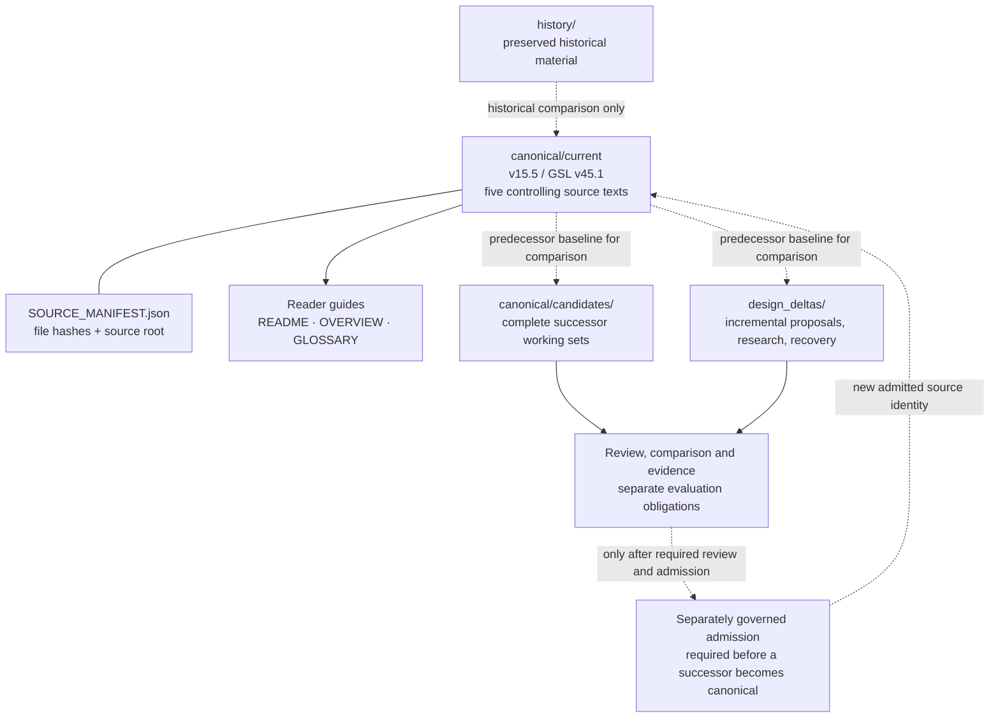

# Garden repository and authority architecture

This page explains how to navigate the repository and how its artifact classes relate. It is a reader guide, not a new Garden semantic specification.

## Repository model

The arrows represent navigation, comparison or a possible governed process. They do **not** mean that a candidate or delta automatically advances to canonical status.

## Artifact classes

### Canonical source

`canonical/current/` contains the sole canonical source release in this repository: Garden v15.5 / GSL v45.1. The five text files are controlling source artifacts. `SOURCE_MANIFEST.json` pins their file identities and source root.

### Whole-release candidates

`canonical/candidates/` contains complete five-file successor working candidates. They are useful for whole-source comparison, but remain noncanonical. A candidate's own manifest identifies that candidate's files; it does not admit the candidate.

### Incremental design deltas

`design_deltas/` contains smaller proposals, technical and research documents, source extracts, recovery records and indexes. These are not duplicate complete releases. A delta can be useful without being accepted, complete or compatible with every other delta.

### Historical archive

`history/` preserves an earlier standalone design snapshot and a notice describing its historical status. It is retained for provenance, comparison and possible recovery. It is not current authority.

### Reader guides

Root-level guides and directory READMEs explain how to navigate the repository. They are secondary documentation: if a guide and a controlling source disagree about Garden semantics, the controlling source takes precedence.

## Authority and evidence are separate

Keep these claims distinct:

1. **Source identity** — the exact bytes and manifest identity of a source set.
2. **Specification** — what the design says should be true or done.
3. **Review** — an examination that may identify strengths, gaps or defects.
4. **Formal proof** — a proof obligation discharged under an explicit proof method.
5. **Implementation** — executable realization of specified behavior.
6. **Empirical validation** — evidence from tests or observations within a stated scope.
7. **Certification or deployment** — separate external or operational claims requiring their own authority and evidence.

None of these should be inferred solely from another. In particular, a hash match is not a proof of correctness, and a passing test is not canonical admission.

## Safe navigation rule

When unsure which document governs a claim, start at [the canonical source guide](canonical/current/README.md), check the manifest, and then follow the relevant source section or stable identifier. Treat later candidate and research material as proposals unless a separate admission record establishes otherwise.
